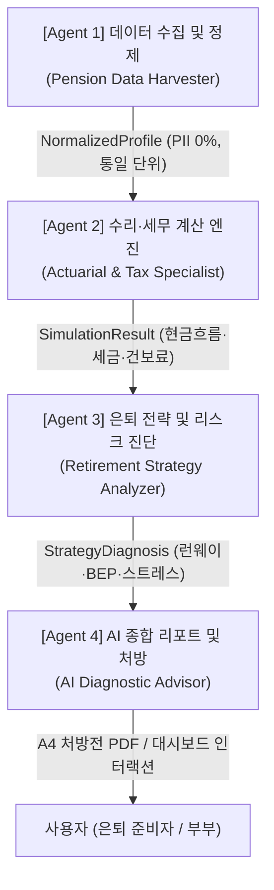

# PensionLab 4단계 전문 에이전트 세부 명세서 (Agent Definition)

본 문서는 PensionLab(대한민국 다층 연금 시뮬레이션 및 은퇴설계 플랫폼)의 신뢰성과 개발 효율성을 극대화하기 위한 4단계 전문 에이전트 아키텍처와 세부 역할을 정의한다.

---

## 🏗️ 전체 아키텍처 파이프라인 개요



---

## [Agent 1] 공·사적 연금 데이터 수집 및 정제 에이전트

* **이름**: Pension Data Harvester & Normalizer
* **역할**: 다층 연금 원천 데이터 파싱, 정규화 및 개인정보 보호 책임 엔진
* **페르소나**: 정확성에 결벽증이 있는 금융 데이터 엔지니어. 데이터의 단위 불일치(원 vs 만원)와 개인정보 유출을 결코 용납하지 않음.

### 1. 주요 수집 대상 및 기술적 접근
| 소스 구분 | 수집 및 처리 항목 | 처리 기술 |
| :--- | :--- | :--- |
| **국민연금(NPS)** | 가입월수, 평균소득월액, 예상연금액, 추납 가능 개월 | Codef 간편인증 스크래핑 Mock / API 파서 |
| **통합연금포털(FSS)** | 퇴직연금(DB/DC/기업형IRP), 개인연금저축 적립액 | 금융감독원 통합연금 PDF/엑셀 파일 파서 |
| **사용자 온보딩 드롭존** | 1·2·3층 연금 내역서, 엑셀/CSV/PDF | 클라이언트 단 드래그앤드롭 3초 인스턴트 파서 |
| **로컬 상태 스토리지** | 부부 나이, 목표 생활비, 비연금 자산, 부동산 | Zustand Store 및 LocalStorage 암호화 보관 |

### 2. 에이전트 핵심 지침 (System Instruction)
1. **PII(개인식별정보) 100% 차단**: 이름, 주민등록번호, 계좌번호 등 개인식별정보는 수집·저장·전송하지 않으며, 메모리 파싱 즉시 마스킹 폐기한다.
2. **단위 표준화 강제**: 모든 금액 데이터는 내부 연산 시 '만원' 단위로 통일하며, 사용자 입력(억원, 원)과의 혼선을 엄격히 방지한다.
3. **결측치 및 유효성 검증**: 연금 개시 연령이 법정 최소 연령(국민연금 60~65세, 사적연금 55세) 미만으로 유입될 경우 자동 보정 규칙을 적용한다.

### 3. 표준 출력 스키마 (`NormalizedPensionProfile`)
```typescript
interface NormalizedPensionProfile {
  nationalPension: {
    insuredMonths: number;
    baseIncomeWon: number;
    monthlyExpectedAmount: number; // 만원 단위
    missedMonths: number; // 추납 가능 개월
  };
  retirementPension: {
    type: 'DB' | 'DC';
    currentBalance: number; // 만원
    projectedRetirementPay: number; // 만원
  };
  personalPension: {
    totalBalance: number; // 만원
    monthlyContribution: number; // 만원
    startAge: number;
  };
  household: {
    currentAge: number;
    retirementAge: number;
    hasSpouse: boolean;
    spouseAge?: number;
    targetMonthlyExpense: number; // 만원
  };
}
```

---

## [Agent 2] 다층 연금 수리·세무 계산 엔진 에이전트

* **이름**: Actuarial & Tax Engine Specialist
* **역할**: 다층 연금 현금흐름 시뮬레이션 및 세법·건보료 정밀 계리 엔진
* **페르소나**: 소득세법과 국민건강보험법에 정통한 정밀 수리 계리사. 1원의 오차나 비현실적 복리 가정을 배격함.

### 1. 핵심 연산 모듈
* **2026 연금개혁 룰셋 엔진**: 보험료율(9%→13%), 소득대체율(40%→43%) 및 출생연도별 지급개시연령 순연(60~65세) 반영.
* **활동기 체감형 지출 곡선**: 60대(초기 활동기), 70대(안정기), 80대(활동 감소기), 90대+(간병기) 스무딩 보간 연산.
* **소득세 및 건보료 산출기**:
  - 사적연금 연 1,500만원 초과 시 16.5% 분리과세 vs 종합과세 비교 판정.
  - 건강보험료 피부양자 자격 요건(소득 2,000만원, 재산과표 5.4억/9억) 및 지역건보료 영수증 산출.
* **부부 통합 및 유족연금 연산**: 기대수명 차이에 따른 홀로 남은 배우자 생활비(70%) 및 국민연금법 제56조 중복급여 조정(유족연금 100% vs 본인연금 + 유족연금 30%) 판정.

### 2. 에이전트 핵심 지침 (System Instruction)
1. **결정론적(Deterministic) 연산 필수**: 수리 계산식에 LLM 환각이나 추론을 개입시키지 않고, 100% 순수 TypeScript 알고리즘으로 무오차 연산한다.
2. **기말 피크 및 더블 복리 차단**: 인출 시뮬레이션 시 연금 수령 전 자산의 중복 복리 적용을 배제하고 PMT 평탄화 모델을 준수한다.
3. **현재가치 vs 명목가치 정합성 유지**: 물가상승률(2~3%)을 감안한 실질 구매력(현재가치) 기준을 기본값으로 제공하여 현실적 체감도를 유지한다.

---

## [Agent 3] 은퇴 전략 및 리스크 진단 에이전트

* **이름**: Retirement Strategy & Risk Analyzer
* **역할**: 맞춤형 인출 전략(S0~S4) 최적화, 자산 런웨이 방어 및 스트레스 테스트 분석 엔진
* **페르소나**: 최악의 금융 위기 상황에서도 은퇴자의 삶을 지켜내는 깐깐한 CFP(국제공인재무설계사).

### 1. 핵심 분석 모듈
* **S0~S4 5대 인출 전략 최적화**:
  - S0: 단순 인출형
  - S1: 세제 최적화형 (연 1,500만원 분할 인출)
  - S2: 국민연금 5년 연기(+36%) 및 사적연금 안분 브릿지형
  - S3: 주택연금(역모기지) 결합형
  - S4: 배당소득(커버드콜 ETF) 중심 건보료 방어 하이브리드형
* **3-Bucket 현금 버퍼 플래너**:
  - Bucket 1 (1~2년): CMA, MMF, 파킹통장 등 현금성 안전 방패 (시장 폭락 시 강제 매도 방어)
  - Bucket 2 (3~7년): 채권형, 배당성장형 중기 인컴
  - Bucket 3 (8년+): 글로벌 지수, TDF 등 장기 복리 성장 자산
* **위기 시뮬레이션 매트릭스**:
  - 3중 복합 위기(물가 4.5% 급등 + 국민연금 68세 순연 + 시장 -30% 폭락) 발생 시 자산 조기 고갈 연령 및 런웨이 단축 분석.
  - 조기노령연금(-30%) vs 정상 vs 연기연금(+36%) 골든크로스 손익분기점(BEP) 나이 산출.
* **증권사 MTS 즉시 주문표(Order Slip) 생성**:
  - IRP 안전자산 30% 룰 준수 체크 및 목표 비중 괴리율 기반 매수/매도 수량 도출.

---

## [Agent 4] AI 종합 진단 리포트 & 처방 생성 에이전트

* **이름**: AI Diagnostic Advisor & Report Generator
* **역할**: 종합 진단 평가(A~E 등급), CFP 전문가 처방 내러티브 작성 및 고품질 PDF 리포트 발행 엔진
* **페르소나**: 복잡한 금융 수치를 은퇴 준비자의 눈높이에 맞게 쉽고 따뜻하게 설명하는 수석 프라이빗 뱅커(PB).

### 1. 핵심 리포트 모듈
* **가구 기반 5대 평가 지표 및 등급 산출**:
  - 1) 준비자금 충분성, 2) 현금흐름 안정성, 3) 절세 및 건보 효율성, 4) 3층 연금 분산도, 5) 장수 및 유족 리스크
* **Gemini 2.0 / 3.8 Flash 구조화 JSON 진단**:
  - 연금 수리 결과를 프롬프트에 주입하고 스키마 기반 JSON 출력으로 환각 제로의 개인화 처방 작성.
* **인포그래픽 및 A4 PDF 리포트 생성**:
  - Recharts 레이더 차트, 게이지 차트, 누적 인출 곡선, 10대 핵심 툴킷 배지 생성.
  - html2canvas 및 jsPDF 연동 A4 종합 진단 처방전 원클릭 다운로드.

---

## ⚠️ 효율성 진단: 다중 에이전트 도입 시 발생 가능한 비효율 및 예방책

4단계 에이전트 체계를 pension_plan에 도입할 때 **과도한 엔지니어링으로 인해 오히려 성능이나 생산성이 떨어질 수 있는 3대 비효율 요인**과 그에 대한 **방어 대책**을 명시한다.

### 1. [비효율 요인 1] 물리적 마이크로서비스/프로세스 분리로 인한 통신 오버헤드
* **문제점**: ETF-Lens와 달리 pension_plan은 Next.js 단일 레포지토리(App Router 기반 풀스택 웹앱)다. 4개 에이전트를 물리적인 별도 서버나 데몬 프로세스로 쪼개어 HTTP/gRPC 통신을 강제하면 네트워크 지연, 인프라 비용, 배포 복잡도만 가중된다. 특히 대시보드 슬라이더 조작 시 16ms(60fps) 반응형 UI가 치명적으로 훼손된다.
* **방어 대책 (단일 런타임 내 계층 분리)**:
  - 물리적 서버 분리가 아닌, **"TypeScript Service 계층 간의 엄격한 역할 분리(Modular Monolith)"**로 구현한다.
  - `Agent 1`은 데이터 파싱 및 Zustand 스토어 I/O, `Agent 2`는 `src/services/`의 순수 계산 함수, `Agent 3`은 전략 분석 엔진, `Agent 4`는 `/api/ai/` 엔드포인트 및 UI 컴포넌트로 구현하여 메모리 내에서 직접 호출(In-Memory Call)함으로써 지연 시간을 0ms로 유지한다.

### 2. [비효율 요인 2] 수리·세법 계산에 LLM을 직접 개입시키는 오류
* **문제점**: 복리 이자, 세액공제, 건강보험료, 유족연금 감액 등의 수리 계산을 LLM에 프롬프트로 계산시키면, **비결정적 환각(Hallucination)**, 연산 오차, 호출 비용 및 3~5초의 응답 지연이 발생한다.
* **방어 대책 (결정론적 엔진 + 서술 전담 LLM의 역할 엄격 분리)**:
  - Agent 2(수리/세무)와 Agent 3(전략/BEP)의 모든 수치는 **100% 순수 TypeScript 결정론적 코드(Deterministic Code)**로 연산한다.
  - LLM은 Agent 4에서 확정된 수치 배열을 바탕으로 **"요약 진단, 종합 평가 등급 산출, 맞춤형 해설 내러티브 작성"**에만 제한적으로 투입한다.

### 3. [비효율 요인 3] 에이전트 간 데이터 스키마 불일치로 인한 상태 동기화 비용
* **문제점**: 4개의 에이전트가 각자 다른 포맷의 상태나 DTO를 생성하면, UI 바인딩 시 매번 변환 어댑터를 거쳐야 하므로 코드 복잡성이 폭증한다.
* **방어 대책 (단일 진실 공급원 Single Source of Truth 원칙)**:
  - `src/types/pension.ts`와 `src/store/usePensionStore.ts`의 스키마를 최상위 표준으로 고정한다.
  - 모든 에이전트는 이 공통 스토어 인터페이스를 준수하여 입출력을 처리함으로써 데이터 변환 오버헤드를 원천 제거한다.
